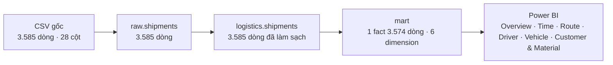

<div align="center">

# Freight Fleet Management

### Phân tích ETA variance và tỷ lệ giao đúng hạn của các chuyến vận tải đường bộ B2B cho Haulix Logistics


</div>

---

## Table of Contents

- [Project Overview](#project-overview)
- [Project Highlights](#project-highlights)
- [Repository Structure](#repository-structure)
- [Raw Data](#raw-data)
- [Data Pipeline](#data-pipeline)
- [Semantic Model](#semantic-model)
- [Dashboard](#dashboard)
- [Key Findings](#key-findings)
- [Tech Stack](#tech-stack)

---

## Project Overview

Dự án bắt đầu từ một file dữ liệu thô `logistics.shipments.csv` gồm 3.585 dòng và 28 cột. Mỗi dòng là một shipment (một chuyến hàng) kèm thông tin theo dõi GPS và ETA (Estimated Time of Arrival, giờ dự kiến đến nơi). Từ file này, dự án xây một pipeline làm sạch bằng T-SQL trên SQL Server qua ba lớp (`raw`, `logistics`, `mart`), một star schema (mô hình sao: một bảng fact ở giữa, các bảng dimension xung quanh) nạp vào Power BI, và một dashboard 6 trang.

Đề bài (case brief) đặt bối cảnh Haulix Logistics, công ty vận tải hàng hóa B2B đường bộ, kết nối supplier và khách hàng qua đội xe tải. Người làm đóng vai Logistics Analyst, dùng dữ liệu GPS để phân tích điểm trễ và hành vi tài xế. Nỗi đau chính là ETA variance và on-time delivery. Brief giao 15 yêu cầu ad-hoc từ Leader và stakeholder, độ khó tăng dần từ cơ bản đến nâng cao.

Các câu hỏi project trả lời:

- Giao hàng có đúng hạn không, trễ bao nhiêu giờ so với kế hoạch? _(Operations Director, Ops manager)_
- Tài xế nào chạy tốt, tài xế nào cần xem lại, chuyến nào chạy chậm bất thường? _(Driver Ops Manager, Operations Director)_
- Xe có được khai thác hết công suất không? _(Fleet Manager)_
- Khách hàng nào có nhiều chuyến nhất và được phục vụ ra sao? _(Head of Sales)_
- Chuyến ngắn hay chuyến dài chiếm nhiều hơn, nhóm nào giao đúng hạn hơn? _(Strategic Planning)_
- Loại hàng nào chở nhiều nhất, quãng đường và thời gian trung bình ra sao? _(Head of Pricing)_
- Số chuyến thay đổi thế nào theo tháng? _(CEO)_

Dữ liệu không có doanh thu, chi phí hay điểm hài lòng của khách hàng, nên câu hỏi lợi nhuận theo route của Sales và mức hài lòng của Customer success không nằm trong phạm vi.

**Nguồn dữ liệu:** dữ liệu thật từ nguồn công khai: [điền tên nguồn và liên kết]. File Excel gốc kèm sheet `Data Dictionary` mô tả đủ 28 cột. Ngày đặt hàng (`Booking Date`) trải từ 15/04/2019 đến 03/12/2020, nhưng ping GPS cuối cùng là 28/08/2020. Phân tích dùng các chuyến đặt từ 01/12/2019 đến 31/08/2020 (3.574 trong 3.585 chuyến). Phạm vi là vận tải đường bộ tại Ấn Độ với 36 khách hàng. Số điện thoại tài xế (`Driver Mobile No`) không được đưa vào model Power BI, và thư mục `Data/` không được đưa lên Git.

---

## Project Highlights

| Area | What this project does |
|---|---|
| Data preparation | Làm sạch 3.585 dòng thô qua 3 lớp `raw` → `logistics` → `mart` bằng 5 script T-SQL chạy theo thứ tự |
| Ad-hoc SQL | Viết truy vấn cho 11 trong 15 câu ad-hoc của brief (Q1 đến Q11), dùng `GROUP BY`, `CASE WHEN`, window function (rolling 7 tuần theo ISO week) |
| Star schema | 1 bảng fact `mart fact_shipment` (3.574 dòng) và 6 bảng dimension, nạp vào Power BI ở chế độ Import |
| DAX | 35 measure chia 6 folder, gồm xếp hạng tài xế, rolling 7 tuần, ngưỡng chuyến chậm bất thường và đổi mốc ngày bằng `USERELATIONSHIP` |
| Dashboard | 6 trang: Overview, Time, Route, Driver, Vehicle, Customer & Material, mỗi chart trả lời một câu hỏi nhỏ |
| Quản lý dự án | Dự án Power BI lưu dạng PBIP (file văn bản TMDL và JSON) để theo dõi thay đổi bằng Git |

---

## Repository Structure

```
Freight Fleet Management/
├── Data/                                   # có sẵn từ đầu, nằm trong .gitignore (có số điện thoại tài xế)
│   ├── logistics.shipments.csv
│   └── logistics.shipments.xlsx            # cùng dữ liệu, thêm sheet Data Dictionary
├── Document/                               # có sẵn từ đầu
│   └── (case brief .docx)                  # đề bài: bối cảnh, stakeholder, 15 câu ad-hoc
├── SQL/
│   ├── Data_preparation/                   # xây trong quá trình làm
│   │   ├── 01_load_raw.sql                 # nạp CSV vào raw.shipments
│   │   ├── 02_profile_raw.sql              # kiểm tra dòng trùng, giá trị trống, giá trị lạ
│   │   ├── 03_clean_and_load.sql           # làm sạch, ép kiểu, nạp logistics.shipments
│   │   ├── 04_validate_clean_data.sql      # kiểm tra lớp đã làm sạch
│   │   └── 05_build_mart.sql               # dựng star schema trong schema mart
│   └── ad_hoc.sql                          # xây trong quá trình làm: truy vấn Q1 đến Q11
├── PowerBI/                                # xây trong quá trình làm
│   ├── Freight Fleet Management.pbip
│   ├── Freight Fleet Management.SemanticModel/   # bảng, quan hệ, measure (TMDL)
│   └── Freight Fleet Management.Report/          # trang và visual (PBIR)
├── Images/                                 # xây trong quá trình làm: ảnh dashboard dùng trong README
├── .gitignore
└── README.md
```

---

## Raw Data

Dữ liệu thô nằm ở `Data/logistics.shipments.csv`, được nạp bằng `BULK INSERT` vào `raw.shipments`. Thư mục `Data/` nằm trong `.gitignore` vì có số điện thoại tài xế. Bản Excel `logistics.shipments.xlsx` chứa cùng dữ liệu (sheet `Primary Data`) và thêm sheet `Data Dictionary`.

| File | Số dòng |
|---|---|
| `logistics.shipments.csv` | 3.585 |
| **Tổng** | **3.585** |

Mỗi dòng là một shipment. Một shipment được nhận diện bằng bộ ba `booking_id`, `customer_name`, `material_shipped`: có 3.582 `booking_id` khác nhau trên 3.585 dòng, và không có dòng nào trùng hoàn toàn.

- `booking_date`: ngày giờ tạo booking
- `trip_start_date`: ngày giờ xe thực sự xuất phát
- `planned_eta`: giờ dự kiến đến nơi theo kế hoạch
- `actual_eta`: giờ thực tế đến nơi, trống ở 25 chuyến chưa đến nơi
- `trip_end_date`: theo Data Dictionary đây là ETA ước tính, không phải giờ kết thúc thực tế, nên không dùng để tính thời gian chuyến
- `ontime`: nhãn đúng hạn (`Yes` hoặc `No`) có sẵn trong nguồn: 1.381 `Yes`, 2.204 `No`
- `shipment_type`: `Market` (đặt lẻ, 58 chuyến) hoặc `Regular` (theo hợp đồng, 3.527 chuyến)
- `transportation_distance_km`: quãng đường, trống ở 148 dòng (4,1%)
- `vehicle_type`: loại xe, 38 nhãn khác nhau, trống ở 764 dòng (21,3%)
- `driver_name`: tên tài xế, trống ở 317 dòng (8,8%)
- `customer_name`, `material_shipped`: khách hàng nhận hàng và loại hàng
- `origin_location`, `destination_location` cùng 4 cột tọa độ: điểm đi và điểm đến
- `gps_provider`: nhà cung cấp GPS theo dõi xe

Các cột `Driver Mobile No` (thông tin cá nhân, trống 28,6%), `Minimum Kms To Be Covered In A Day` (trống 73,8%), `Current Location` và tọa độ hiện tại, `Data Ping time` và `Supplier Name` không được dùng trong phân tích.

`Planned ETA` bằng đúng 100 giờ sau thời điểm đặt hàng ở 2.145 trong 3.583 dòng có đủ hai mốc (59,8%), nên ETA kế hoạch của phần lớn chuyến không phụ thuộc quãng đường. Các chuyến chưa có `Actual ETA` vẫn mang nhãn `Ontime`, nhãn này chỉ là tạm thời.

**Xử lý dữ liệu chính trong `SQL/Data_preparation/03_clean_and_load.sql`:**

- Cắt khoảng trắng (`TRIM`) mọi cột chữ và đổi các giá trị giả null (`'NULL'`, `'NA'`, `'N/A'`, chuỗi rỗng) thành `NULL` thật.
- Đổi tên cột sang snake_case.
- Gộp nhiều khoảng trắng liên tiếp thành một ở `vehicle_type`, `driver_name`, `supplier_name`, `material_shipped` bằng ba lần `REPLACE` qua ký tự tạm `<>`.
- Ép kiểu bằng `TRY_CAST`: ngày giờ thành `DATETIME`, tọa độ thành `DECIMAL(9,6)`, quãng đường thành `DECIMAL(10,2)`.
- Đặt `NULL` cho mọi ngày trước 01/01/2000 (ví dụ `1899-12-30`, giá trị giữ chỗ khi ngày trống).
- Viết hoa `vehicle_registration` và loại các dòng thiếu `booking_id` (không có dòng nào bị loại, `logistics.shipments` giữ đủ 3.585 dòng).

**Xử lý dữ liệu chính trong `SQL/Data_preparation/05_build_mart.sql`:**

- Tạo view `mart.v_shipments_in_scope` lọc `booking_date` từ 01/12/2019 đến 31/08/2020, mọi bảng mart đọc từ view này. View loại 11 chuyến: 6 chuyến có mốc thời gian mâu thuẫn (ngày đặt từ tháng 9 đến 12/2020 nhưng ping GPS và ETA thực tế ở tháng 7 và 8/2020), 2 chuyến có ngày giữ chỗ và 3 chuyến đặt trước 01/12/2019. Lớp `logistics` vẫn giữ đủ 3.585 dòng cho các truy vấn ad-hoc.
- Bỏ `driver_mobile_no` vì là thông tin cá nhân. Tài xế được nhận diện theo `driver_name`, 314 chuyến không có tên gắn vào dòng `Unknown` (khóa 0). Tài xế trùng tên bị gộp, tên viết khác nhau không được gộp.
- Chuẩn hóa loại xe bằng bảng map thủ công: 38 nhãn gốc thành 27 loại chuẩn (`vehicle_type_std`) và tải trọng `payload_mt`. Khi một biển số xe có nhiều loại, chọn loại xuất hiện nhiều nhất, nếu hòa thì lấy loại của booking mới nhất.
- Tính các cột phái sinh trong `fact_shipment`: `is_ontime` (1 nếu `ontime = 'Yes'`), `eta_variance_hours` (`actual_eta` trừ `planned_eta`, tính bằng giờ), `trip_duration_hours` (`actual_eta` trừ `trip_start_date`, chỉ khi `actual_eta` sau `trip_start_date`), `hours_per_km` (chỉ khi quãng đường và thời gian đều lớn hơn 0) và `trip_start_hour`.
- Chia nhóm: `distance_band` (dưới 100 km, 100 đến dưới 500, 500 đến dưới 1.000, từ 1.000 km, thiếu quãng đường là `Unknown`), `payload_group` (Light dưới 3 tấn, Medium dưới 10, Heavy dưới 20, Extra heavy từ 20) và `eta_variance_band` (7 nhóm, từ sớm hơn 1 ngày đến trễ hơn 7 ngày, thêm nhóm chưa có ETA thực tế).
- Dựng `dim_date` gồm 275 ngày từ 01/12/2019 đến 31/08/2020, có tuần ISO (`iso_week_start`) và tên tháng, tên thứ bằng tiếng Anh.

---

## Data Pipeline



---

## Semantic Model

Star schema trong schema `mart`:

- `mart fact_shipment`: grain (mức chi tiết của một dòng) là một shipment, 3.574 dòng. Nối tới 6 dimension, có 3 khóa ngày.
- `mart dim_date`: một ngày, 275 dòng. Nối với fact qua `booking_date_key` (quan hệ đang bật), `trip_start_date_key` và `actual_eta_date_key` (quan hệ tắt, chỉ dùng khi measure gọi `USERELATIONSHIP`).
- `mart dim_customer`: một khách hàng, 36 dòng.
- `mart dim_material`: một loại hàng, 708 dòng.
- `mart dim_route`: một tuyến (điểm đi và điểm đến), 517 dòng, có nhãn `route_label`.
- `mart dim_driver`: một tên tài xế, 1.232 dòng gồm cả dòng `Unknown`.
- `mart dim_vehicle`: một biển số xe, 1.256 dòng, kèm `vehicle_type_std`.
- `_Measures`: bảng chỉ chứa measure và cột tham số `Minimum Shipments` (5, 10, 20), không chứa dữ liệu.

Không có bảng dimension riêng cho loại xe (`Dim_Vehicle_Type`) và cho các nhóm: loại xe nằm trong `mart dim_vehicle`, còn `distance_band`, `payload_group`, `eta_variance_band`, `trip_start_hour` nằm ngay trong `mart fact_shipment` để model gọn.

Model có 35 measure chia 6 folder: `1 Volume`, `2 Delivery quality`, `3 Efficiency`, `4 Trend`, `5 Ranking` và `Parameters`. Trong đó 15 measure được dùng trực tiếp trên dashboard.

Các measure phức tạp nhất:

- `Driver Rank`: dùng `ADDCOLUMNS`, `FILTER` và `ALLSELECTED` để xếp hạng tài xế theo tỷ lệ đúng hạn, hòa thì ưu tiên tài xế nhiều chuyến hơn, bỏ qua tài xế `Unknown` và tài xế dưới ngưỡng chuyến tối thiểu.
- `On-time Rate Rolling 7W`: dùng `CALCULATE` kèm `ALLSELECTED` và cửa sổ 42 ngày quanh `iso_week_start`, cộng tử số và mẫu số của 7 tuần rồi mới chia, không lấy trung bình tỷ lệ từng tuần.
- `Slow Trips`: dùng `VAR` đặt ngưỡng bằng 2 × `Overall Hours per km` (tính sau khi gỡ mọi bộ lọc), rồi `CALCULATE` đếm các chuyến có `hours_per_km` từ ngưỡng đó trở lên.
- `Qualified On-time Rate`: so `Shipments` với giá trị slicer `Minimum Shipments` (lấy bằng `SELECTEDVALUE`, mặc định 10) để ẩn nhóm quá ít chuyến khỏi bảng xếp hạng.
- `On-time Rate by Trip Start`: dùng `USERELATIONSHIP` để đếm theo ngày xuất phát thay vì ngày đặt hàng.
- `Hours per km`: dùng `SUMX` trên tập chuyến hợp lệ, lấy tổng giờ chia tổng km nên chuyến ngắn không làm lệch kết quả.

---

## Dashboard

**1. Overview**: 6 thẻ KPI (`Shipments`, `On-time Rate`, `Avg ETA Variance (h)`, `Severely Late %`, `Active Vehicles`, `Active Customers`), chart số chuyến kết hợp tỷ lệ đúng hạn theo tháng, bản đồ điểm đến, cột xếp chồng chuyến đúng hạn và trễ theo nhóm khoảng cách, và cột số chuyến theo nhóm mức trễ.


**2. Time**: cột xếp chồng 100% cơ cấu mức trễ theo tháng, đường trung vị thời gian chuyến theo tháng, và hai chart kết hợp số chuyến với tỷ lệ đúng hạn theo thứ trong tuần và theo giờ xuất phát.


**3. Route**: top 10 tuyến theo số chuyến trễ, scatter số chuyến × tỷ lệ đúng hạn của từng tuyến, bảng nhiệt độ lệch ETA theo tuyến × giờ xuất phát, và scatter quãng đường × trung vị thời gian chuyến.


**4. Driver**: top 10 tài xế theo số chuyến trễ, scatter số chuyến × tỷ lệ đúng hạn và quãng đường × tỷ lệ đúng hạn của từng tài xế, `Slow Trips %` theo tháng và top 10 tuyến theo số chuyến chạy chậm bất thường.


**5. Vehicle**: top 10 loại xe và nhóm tải trọng theo số chuyến đúng hạn và trễ, độ lệch ETA trung bình theo loại xe, và số chuyến mỗi xe theo tháng và theo loại xe.


**6. Customer & Material**: top 10 khách hàng và top 10 loại hàng theo số chuyến đúng hạn và trễ, quãng đường trung bình và trung vị thời gian chuyến của từng loại hàng.


---

## Key Findings

> **ETA** (Estimated Time of Arrival) là giờ dự kiến đến nơi. `Planned ETA` là giờ theo kế hoạch, `Actual ETA` là giờ thực tế.
>
> **ETA variance** là `Actual ETA` trừ `Planned ETA`, tính bằng giờ. Số dương là trễ, số âm là sớm.
>
> **On-time** là chuyến có nhãn `Ontime = Yes` trong dữ liệu gốc, **late** là chuyến có nhãn `No`.
>
> **Severely late** là chuyến đến trễ hơn 72 giờ (3 ngày) so với `Planned ETA`.
>
> **Slow trip** là chuyến có số giờ trên mỗi km ít nhất gấp đôi mức trung bình của toàn bộ dữ liệu.

**Insight từ dữ liệu:**

- Trong **3.574** chuyến, chỉ **38,4%** giao đúng hạn (**1.374** chuyến), còn **2.200** chuyến trễ. Trong các chuyến đã có giờ đến thực tế, **38,3%** trễ hơn 3 ngày.
- Nhóm chuyến từ 1.000 km trở lên có **1.058** chuyến trễ, chiếm **48,1%** tổng số chuyến trễ, và chỉ đúng hạn **21,3%**, thấp hơn hẳn nhóm 100 đến dưới 500 km (**65,2%**). Với **59,8%** số chuyến, `Planned ETA` cách thời điểm đặt hàng đúng 100 giờ, không phụ thuộc quãng đường.
- Từ 12/2019 đến 5/2020, tỷ lệ đúng hạn mỗi tháng chỉ từ **0%** đến **1,1%**. Sang tháng 6/2020 là **23,4%**, tháng 7/2020 là **31,2%**, tháng 8/2020 là **67,0%**. Trong các tháng đầu chỉ có **1** khách hàng, đến tháng 8/2020 có **34** khách hàng.
- Ericsson India đúng hạn **1,5%** (**197** trên **200** chuyến trễ), còn Ashok Leyland đúng hạn **91,0%** (**234** chuyến). Larsen & Toubro có nhiều chuyến nhất (**972**) và đúng hạn **20,5%**.
- Chuyến xuất phát buổi chiều (12 đến 17 giờ) chiếm **54,5%** số chuyến và đúng hạn **36,9%**, thấp hơn buổi sáng (**43,0%**). Chuyến xuất phát thứ bảy đúng hạn **29,0%** và chủ nhật **25,4%**, thấp hơn thứ hai (**43,8%**).
- Ba nhóm tải trọng Medium, Heavy, Extra heavy (**2.639** chuyến) đúng hạn từ **20,0%** đến **23,4%**. Nhóm chuyến không rõ tải trọng (**863** chuyến) đúng hạn **86,6%**.
- Chuyến Market (đặt lẻ, **58** chuyến) đúng hạn **81,0%**, cao hơn chuyến Regular (**3.516** chuyến) ở mức **37,7%**.
- **944** chuyến chạy chậm bất thường (**27,9%** số chuyến có đủ quãng đường và thời gian).
- 10 tuyến có nhiều chuyến trễ nhất chiếm **547** trong **2.200** chuyến trễ (**24,9%**).
- Thời gian chuyến trung vị là **106,6** giờ, thấp hơn nhiều so với trung bình **215,1** giờ.

**Đề xuất hành động:**

1. Đặt ETA kế hoạch theo quãng đường cho các chuyến dài: ETA hiện được đặt cùng một mốc cho phần lớn chuyến, trong khi nhóm chuyến dài đóng góp nhiều chuyến trễ nhất.
2. Rà soát ETA và cách điều xe của ba khách có nhiều chuyến trễ nhất là Larsen & Toubro, Ford India và Ericsson India: ba khách này nằm trong nhóm khách có nhiều chuyến nhất và tỷ lệ đúng hạn thấp rõ rệt.
3. Bổ sung thông tin loại xe, tải trọng và quãng đường cho các chuyến còn thiếu: các nhóm `Unknown` có tỷ lệ đúng hạn khác hẳn các nhóm còn lại, làm số liệu chung bị trộn lẫn.
4. So sánh riêng chuyến xuất phát buổi chiều, buổi tối và cuối tuần trong cùng một tuyến trước khi đổi lịch xe: các khung này có tỷ lệ đúng hạn thấp hơn, nhưng khách hàng và tuyến thay đổi theo thời gian nên chưa thể gán cho khung giờ.
5. Kiểm tra lại các chuyến chạy chậm bất thường ở những tuyến có nhiều chuyến chậm nhất: số giờ trên mỗi km của các chuyến này cao gấp đôi mức chung.

---

## Tech Stack

- SQL Server
- T-SQL
- Power BI Desktop
- DAX
- Power Query (M)
- Power BI Project (PBIP, TMDL)
- Mermaid
- Git
- GitHub
